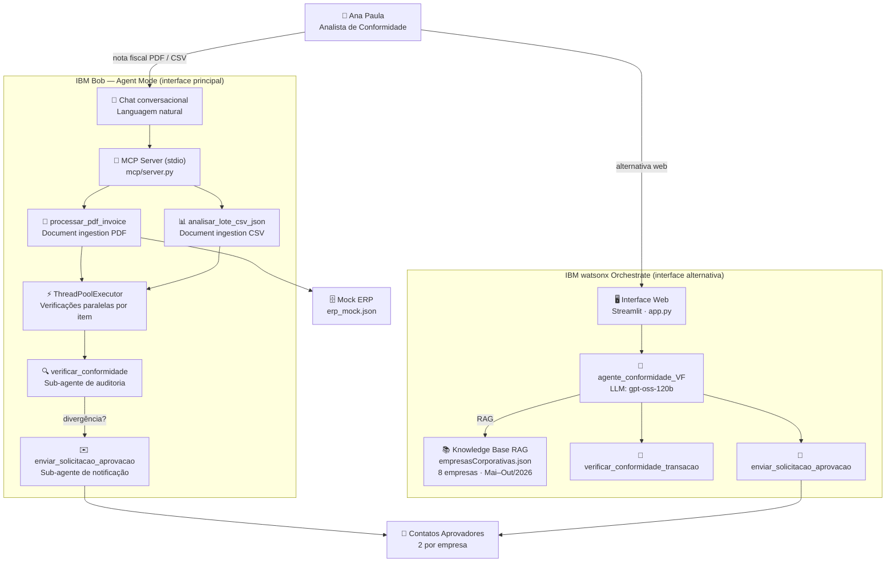

# Agente de Conformidade de Compras — VF (Versão Final)

> **IBM SkillsBuild AI Experiential Learning Lab for Brazil**
> Desenvolvido com IBM Bob (Agent Mode) · IBM watsonx Orchestrate · Streamlit

Agente de conformidade de compras que usa o **IBM Bob no Agent Mode** como motor conversacional central para **ingerir documentos de negócio** (notas fiscais PDF, CSVs de transações), verificar conformidade com o histórico da empresa e acionar aprovadores automaticamente.

---

## O Problema

**Stakeholder:** Ana Paula, Analista de Conformidade de Compras — responsável por auditar mensalmente as transações de 8 empresas do grupo e acionar os 2 aprovadores designados por empresa.

Hoje ela gasta **~5 horas/mês** fazendo isso manualmente, em planilhas, consultando históricos em sistemas separados. Uma nota fiscal com item irregular pode levar **2–3 dias úteis** para ser escalada ao aprovador correto — e nesse intervalo o pagamento pode já ter sido processado.

---

## Impacto de Negócio

| Métrica | Antes (manual) | Depois (automatizado) |
|---|---|---|
| Tempo de auditoria mensal (8 empresas) | ~5 horas | ~5 minutos |
| **Redução de tempo para Ana Paula** | — | **~98%** (5h → ~5min) |
| Tempo para processar 1 nota fiscal | 20–30 min | < 10 segundos |
| Acionamento dos aprovadores | 2–3 dias úteis | Imediato |
| Cobertura de transações auditadas | Parcial | 100% |
| Escalabilidade | Linear | Constante |

**Caso concreto:** Em Novembro/2026, a empresa Beta Solutions apresentou um fornecedor novo (`TechParts Ltda`) e valor 23% acima da média histórica. Com o processo manual, a anomalia seria detectada após ~5h e escalada 2 dias depois. Com o Agente de Conformidade no IBM Bob, detecção e acionamento dos aprovadores ocorreram em **menos de 10 segundos** após a entrega da nota fiscal.

---

## IBM Bob no Agent Mode — Caso Central

O fluxo principal demonstra o **IBM Bob no Agent Mode fazendo document understanding de um business document real**:

1. O usuário entrega ao Bob em linguagem natural: *"Processe a nota fiscal INV-2026-1142.pdf"*
2. O Bob, no **Agent Mode**, aciona a ferramenta MCP `processar_pdf_invoice`
3. A ferramenta ingere o PDF via `pdfplumber`, extrai campos do cabeçalho (empresa, período, localização) e a tabela de line items
4. Para cada line item, um sub-agente verifica a conformidade em paralelo via `ThreadPoolExecutor`
5. O resultado estruturado é registrado no mock ERP
6. O Bob consolida e apresenta o diagnóstico completo — itens em conformidade, divergências e aprovadores a acionar

Tudo isso acontece em **uma única interação conversacional**, sem nenhuma intervenção manual entre a entrega do documento e a decisão de conformidade.

---

## Arquitetura da Solução



---

## Critérios de Conformidade

O agente verifica **3 critérios** em cada transação:

| # | Critério | Dispara aprovação quando… |
|---|----------|--------------------------|
| 1 | **Valor > 15%** | O valor total é mais de 15% acima da média histórica mensal |
| 2 | **Fornecedor novo** | O fornecedor **não está** no histórico de compras da empresa |
| 3 | **Localização nova** | A localização **não está** no histórico da empresa |

Se **qualquer um** dos critérios for verdadeiro, a solicitação de aprovação é enviada automaticamente para os **2 contatos responsáveis** cadastrados na knowledge base.

---

## Estrutura do Projeto

```
Agente-de-IA-IBM/
├── app.py                           # Interface web Streamlit (frontend alternativo)
├── agente_conformidade_VF.yaml      # Spec do agente nativo (WXO)
├── README.md                        # Este arquivo
├── requirements.txt                 # Dependências Python
├── workspace_config.yaml            # Configuração de pastas do workspace WXO
├── prompt_sistema.md                # Documentação do prompt/instruções do agente
├── exemplo_saida.md                 # Exemplo real de saída do agente
├── declaracao_problema_solucao.md   # Declaração do problema e solução (desafio)
├── declaracao_tecnologia.md         # Declaração da tecnologia utilizada (desafio)
├── tools/
│   └── conformidade_vf_tools.py     # 2 ferramentas Python do agente WXO
├── knowledge_base/
│   ├── conformidade_vf_kb.yaml      # Spec da knowledge base
│   └── docs/
│       └── empresas_corporativas.json  # Histórico + contatos das 8 empresas
├── mcp/                             # ← IBM Bob Agent Mode (interface principal)
│   ├── server.py                    # MCP server com 8 ferramentas
│   ├── requirements.txt             # mcp[cli], pdfplumber, reportlab
│   ├── README.md                    # Instruções de registro do MCP server
│   ├── gerar_nota_fiscal_pdf.py     # Script para regenerar o PDF da nota fiscal
│   └── dados/
│       ├── transacoes_novembro_2026.csv      # 6 transações (3 com divergências planejadas)
│       ├── invoice_novembro_2026.json        # Invoice JSON com 3 line items
│       ├── nota_fiscal_INV-2026-1142.pdf     # Nota fiscal PDF (business document)
│       └── erp_mock.json                    # Mock ERP (recebe resultados estruturados)
└── tests/
    └── test_conformidade_vf.py      # 30 testes unitários (100% pass)
```

---

## Como o IBM Bob foi usado

O IBM Bob foi usado em **duas dimensões**:

### 1. Em produção — motor conversacional no Agent Mode

O fluxo central da solução passa pelo IBM Bob:

| Ferramenta MCP | Papel |
|---|---|
| `processar_pdf_invoice` | **Document ingestion** — ingere nota fiscal PDF, extrai campos e line items via pdfplumber |
| `processar_invoice` | **Document ingestion** — ingere invoice JSON e processa line items em paralelo |
| `analisar_lote_csv_json` | **Document ingestion** — ingere CSV de transações, verifica todas as empresas em paralelo |
| `verificar_conformidade` | Sub-agente de auditoria — aplica os 3 critérios para uma empresa |
| `enviar_solicitacao_aprovacao` | Sub-agente de notificação — gera e-mails formais para os aprovadores |
| `listar_empresas` | Sub-agente de descoberta — retorna as 8 empresas da knowledge base |
| `obter_empresa` | Sub-agente de contexto — recupera histórico completo por ID ou nome |

### 2. Durante o desenvolvimento — copiloto de engenharia

| Atividade | Contribuição do IBM Bob |
|---|---|
| **Arquitetura** | Identificou e reorganizou dois projetos misturados no repositório, eliminou duplicatas |
| **Frontend** | Criou integralmente o `app.py` — conexão WXO SDK, renderização HTML/CSS, secrets |
| **MCP Server** | Projetou e implementou `mcp/server.py` com 8 ferramentas, incluindo paralelismo com `ThreadPoolExecutor` |
| **Depuração** | Diagnosticou URL errada da instância WXO, PATH do CLI, bugs de unicode no parser |
| **Segurança** | Criou `.gitignore`, `.env.example`, configurou secrets para Streamlit Cloud |
| **Documentação** | Redigiu README, declarações do desafio, diagrama de arquitetura |

> Todo o código e documentação deste repositório foi produzido em sessão colaborativa com IBM Bob.

---

## Configuração do IBM Bob (MCP Server)

### 1. Instalar dependências do MCP server

```powershell
cd mcp
pip install -r requirements.txt
```

### 2. Registrar o servidor no Bob

O arquivo `.bob/mcp.json` já está configurado no workspace. Para verificar:

```powershell
cat .bob/mcp.json
```

### 3. Testar no Bob (Agent Mode)

Abra o IBM Bob e experimente:

```
Processe a nota fiscal mcp/dados/nota_fiscal_INV-2026-1142.pdf
```

```
Analise o lote de transações mcp/dados/transacoes_novembro_2026.csv
```

---

## Configuração da Interface Web (Streamlit)

### 1. Instalar dependências

```powershell
pip install -r requirements.txt
```

### 2. Configurar credenciais

```powershell
Copy-Item .env.example .env
notepad .env
```

Conteúdo do `.env`:

```
ORCHESTRATE_URL=https://api.eu-de.watson-orchestrate.cloud.ibm.com/instances/1091e0d5-81f5-485a-8628-6e8b821e3bdf
ORCHESTRATE_API_KEY=<sua-ibm-cloud-api-key>
```

### 3. Adicionar e ativar o ambiente WXO

```powershell
orchestrate env add --name cloud --url "https://api.eu-de.watson-orchestrate.cloud.ibm.com/instances/1091e0d5-81f5-485a-8628-6e8b821e3bdf" --type ibm_iam --activate
```

### 4. Importar agente (se ainda não existir)

```powershell
orchestrate knowledge-bases import -f knowledge_base/conformidade_vf_kb.yaml
orchestrate tools import -k python -f tools/conformidade_vf_tools.py
orchestrate agents import -f agente_conformidade_VF.yaml
```

### 5. Executar

```powershell
python -m streamlit run app.py
```

Acesse em: **http://localhost:8501**

---

## Testes

Execute os 30 testes unitários:

```bash
python -X utf8 tests/test_conformidade_vf.py
```

Resultado esperado: **30/30 ✅ PASS, 0 FAIL, 0 ERROR**
